.. _advancedCFD:

Community level wind simulation: WE-UQ coupled with BRAILS++
------------------------------------------------------------

**Tanmay Vora, Jieling Jiang, Abiy F. Melaku, Seymour Spence, Ann Jeffers, Frank McKenna**

Introduction
^^^^^^^^^^^^

CommunityWindSim provides a workflow for simulating wind flow within a community of buildings, defined by those buildings within the region of interest. This workflow has been integrated into `WE-UQ <https://github.com/NHERI-SimCenter/WE-UQ/tree/master>`_ and can be run using its GUI. Additionally, the workflow can be run by the user executing the `Python script <https://github.com/tpvora-lgtm/WE-UQ-CommunityWindSim/tree/main/src/CommunityWindSim>`_ that orchestrates the full pre-processing chain required for a computational fluid dynamics (CFD) simulation of urban wind flow. Specifically, the script performs the following **two** steps: **1**) Building footprints for the community of interest and its surrounding region are first generated using BRAILS++ **2**) Using user-provided inputs defining the parameters of the computational simulation, specifically the computational domain, boundary conditions, turbulence modeling, the script finishes by generating all the input files required for an OpenFOAM CFD simulation.  Once the input files have been generated, the user can run the wind simulation in OpenFOAM, and finally view the results in Paraview. The following modules are required to use this framework:

1. Python3

2. `BRAILS++ <https://nheri-simcenter.github.io/BrailsPlusPlus/rst-doc/install.html>`_

3. OpenFOAM v10

4. Paraview

5. trimesh, geopandas and shapely

6. `TINF <https://nheri-simcenter.github.io/TinF-Documentation/building.html>`_

.. _fig-advanced-cfd-1:

.. figure:: figures/Picture1.png
   :align: center
   :width: 75%

   The WE-UQ and BRAILS++ integration workflow.

Running with WE-UQ
^^^^^^^^^^^^^^^^^^
The desktop application of WE-UQ is available `here <https://www.designsafe-ci.org/data/browser/tapis/designsafe.storage.community/SimCenter%2FSoftware%2FWE_UQ>`_. Documentation and installation instructions are provided `here <https://nheri-simcenter.github.io/WE-UQ-Documentation/>`_. Case folder entry will the name of the OpenFOAM case folder. Wind direction is the angle (in degrees) measured from the West-to-East direction, and the number of processors are required to run the simulation in parallel. The inputs to GUI of WE-UQ consists of three parts:

1. Geographic Extent - Total region is defined by center point and bounding radius. Region of interest (ROI) is defined by a bounding box with minimum and maximum latitudes and longitudes.

.. _fig-f2:

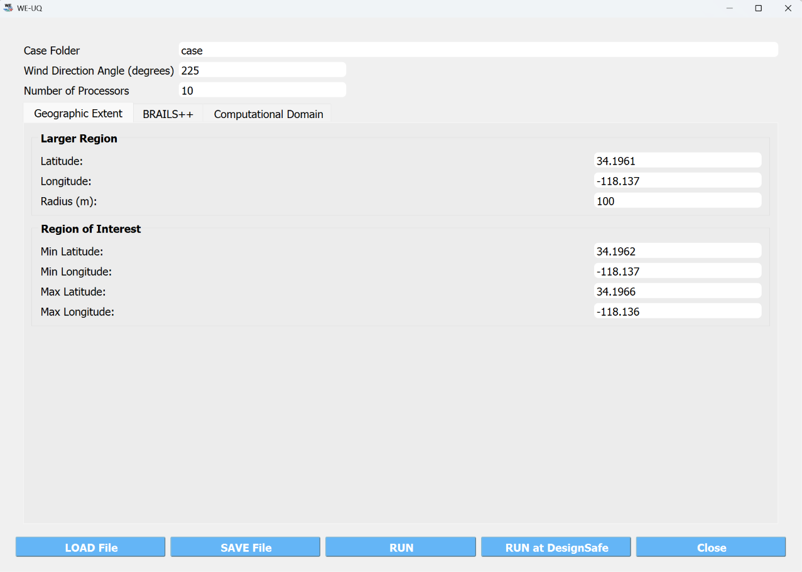

2. Footprint Scraper - Three footprint scrapers are available, namely, USA, MS, and OSM. Default height represents the height of a building whose information is missing.

.. _fig-f3:

.. figure:: figures/BRAILS++.png
   :align: center
   :width: 75%

3. CFD Parameters - The Boundary Mesh Cell Size represents the size of the cells in the background (blockMesh). Refinement levels are relative to this cell size, and the number of cells between layers define the minimum number of cells between two levels. CFD parameters are further divided into four sub parts:

a. Domain Extents - These represent the distance of the boundaries from the nearest building in terms of the maximum height of the buildings (Hmax).  

.. _fig-f4:

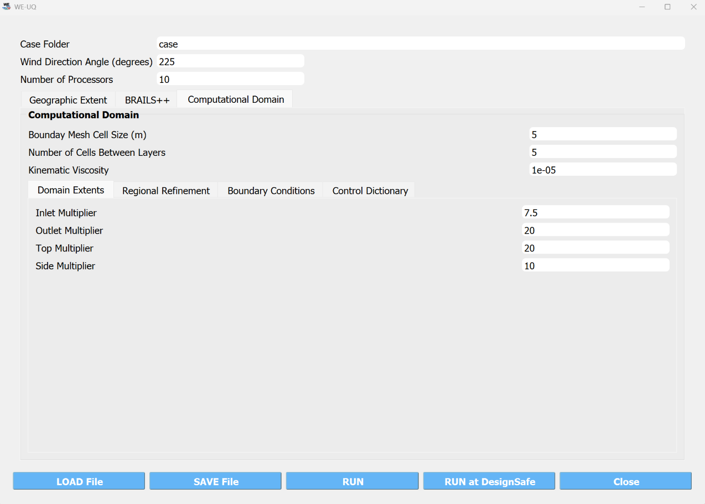

b. Regional Refinement - This widget allows the users to define refinement levels inside the domain to resolve the flow field with more accuracy near the buildings. Each region is defined as a box and each level leads to a twofold decrease in the cell size from the previous level (for example level 1 cell size will be background cell/2 and level 2 cell size will be level 1 cell/2 and so forth).

.. _fig-f5:

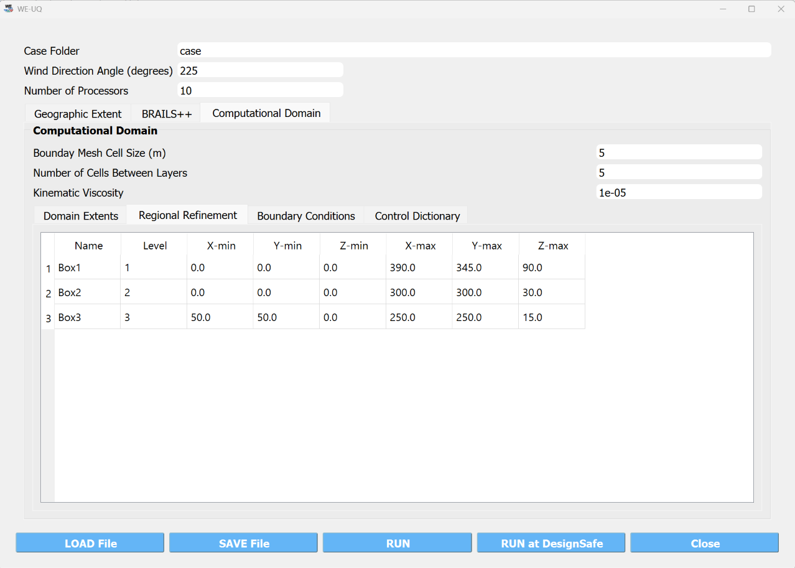

c. Boundary Conditions - The boundary condition for each boundary patch must be defined along with the turbulence framework and its corresponding submodel. To use a turbulent inflow at the inlet, a CSV file must be provided (example of a CSV file can be found `here <https://github.com/tpvora-lgtm/WE-UQ-CommunityWindSim/blob/main/src/CommunityWindSim/wind_profile.csv>`_). The parameters Uref, Href, and z0 are used to calibrate the mean logarithmic inlet velocity.

.. _fig-f6:

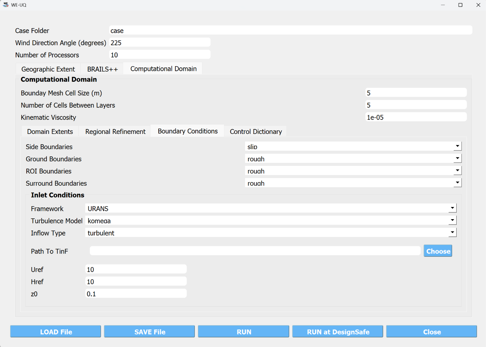

d. Control Dictionary - In this widget, solver and time parameters are required. Additionally, multiple section planes and profile lines for storing the time histories of variables can be defined.

.. _fig-f7:

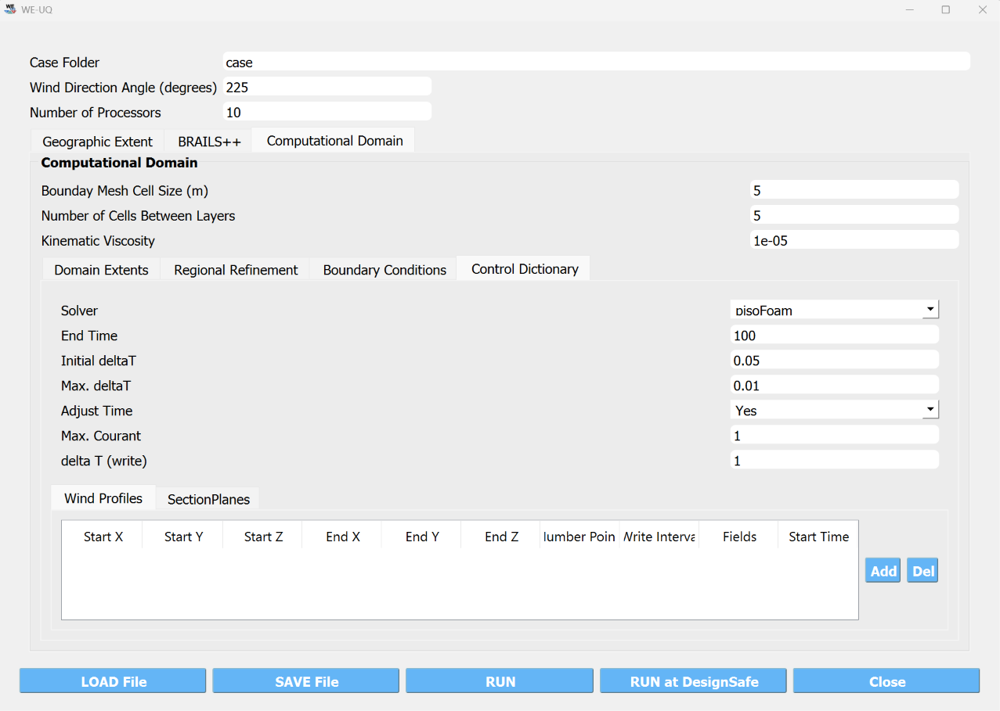

Running the Python Script on its own
^^^^^^^^^^^^^^^^^^^^^^^^^^^^^^^^^^^^
The Python script in the src/CommunityWindSim can alternatively run without the WE-UQ GUI. An example input JSON file and TINF CSV file are provided in the directory to illustrate the inputs to the script. Before running the script, some dictionaries must be installed using the following commands:

``pip install git+https://github.com/NHERI-SimCenter/BrailsPlusPlus``

``pip install geopandas shapely pyproj trimesh rtree mapbox-earcut``

The script can then run using the following command:

``python community_wind_simulation.py input.json``

OpenFOAM Simulation
^^^^^^^^^^^^^^^^^^^
Both the above methods produce two GeoJSON files and an OpenFOAM case folder as shown below. The simulation can be run using the following commands:

.. _fig-f8:

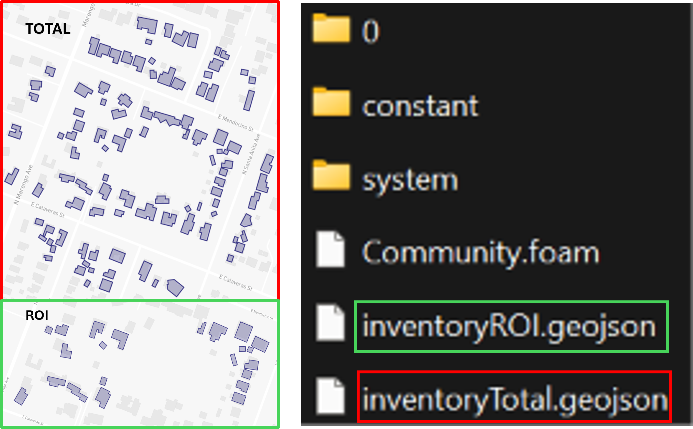

1. In Serial:

``blockMesh``

``surfaceFeatures``

``snappyHexMesh -overwrite``

``simpleFoam``

or 

``pimpleFoam``

or

``pisoFoam``

Depending the solver chosen!

2. In Parallel:

``blockMesh``

``surfaceFeatures``

``decomposePar``

``mpirun -np {number of processors chosen} snappyHexMesh -overwrite -parallel > log.snappy``

``reconstructParMesh -constant``

``decomposePar -force``

``mpirun -np {number of processors chosen} simpleFoam -parallel > log &``

or 

``mpirun -np {number of processors chosen} pimpleFoam -parallel > log &``

or

``mpirun -np {number of processors chosen} pisoFoam -parallel > log &``

Depending the solver chosen!

Example
^^^^^^^^
This example provides a step-by-step guide for performing a community-level wind simulation using the CommunityWindSim framework. The input.json file for this example is shown here.

.. _fig-ex1:

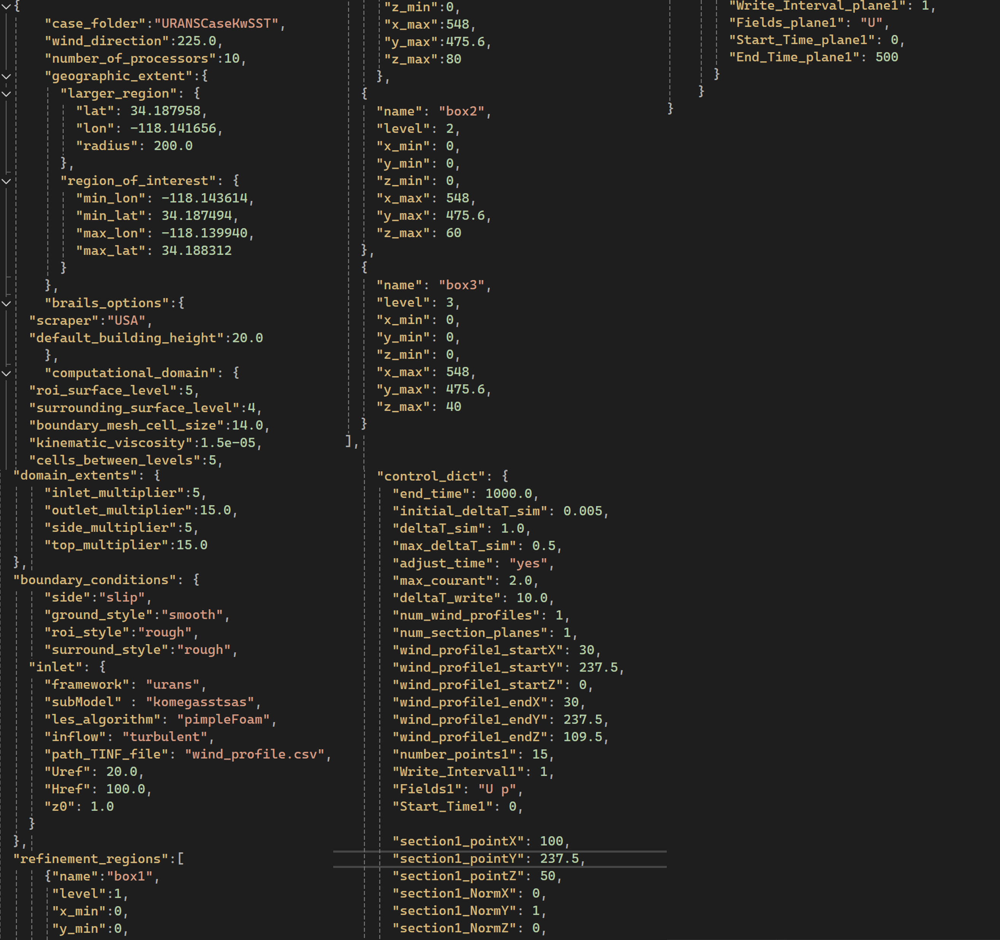

Target region for the simulation
"""""""""""""""""""""""""""""""""
The total region is selected as the circle of radius 200 m with the center coordinate (34.187958, -118.141656) which represents an area in Altadena. The region of interest is the bounding box represented by the (`min_lat`, `min_lon`) and (`max_lat`, `max_lon`) coordinates. The wind direction is chosen to be South-West (225°).

.. _fig-ex2:

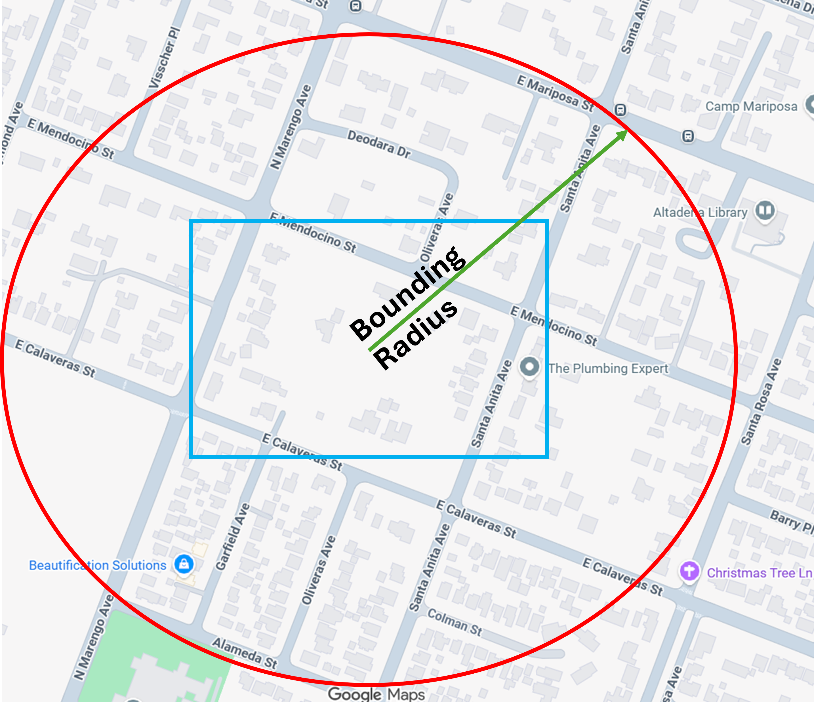

Computational Domain and Mesh
""""""""""""""""""""
The domain extents are determined according to the COST 732 Best Practice Guidelines (Franke et al. 2007). Hmax is the maximum height of the set of buildings. 

.. _fig-ex3:

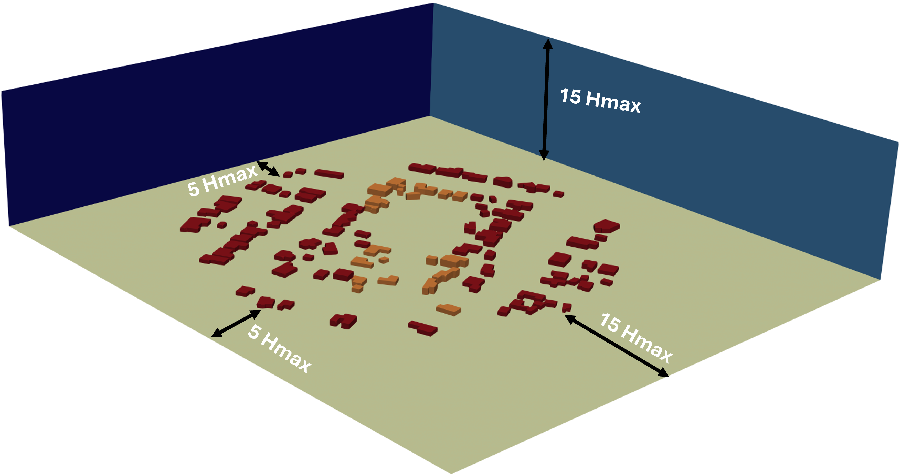

Three mesh refinement regions are defined as shown in the figure. The background mesh size of 14 m was chosen to keep the number of cells small for this example. The Surrounding buildings are resolved with a refinement level of 4 and the ROI buildings are resolved with a refinement level of 5.

.. _fig-ex4:

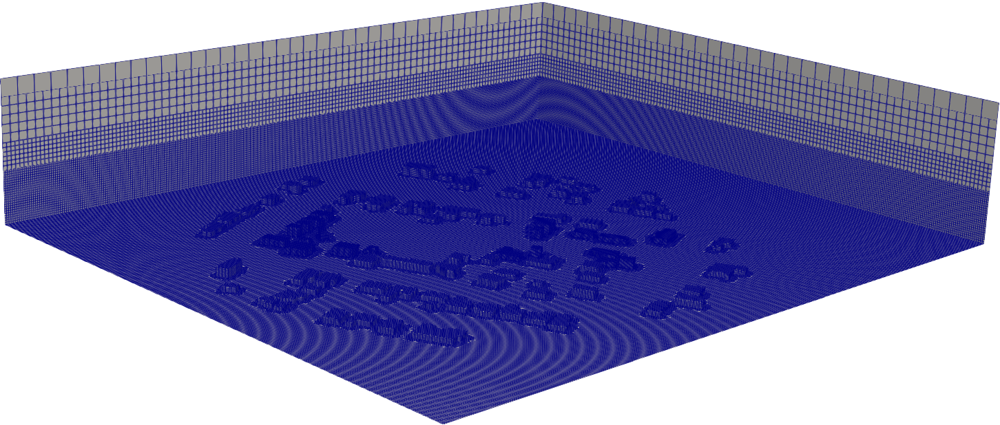

Boundary Conditions
"""""""""""""""""""
A turbulent inflow is applied at the inlet of the domain, side boundaries are assumed as slip, ground boundaries are assumed as smooth and buildings are assumed as rough walls.

Simulation Parameters
"""""""""""""""""""""
A PIMPLE based algorithm is used to solve the Navier-Stokes equations using a URANS formulation with a k-ω SST model. The timestep is adjusted according to the maximum Courant number of 2. A profile line and a section plane is chosen to store data at every time instant and shown below.

.. _fig-ex5:

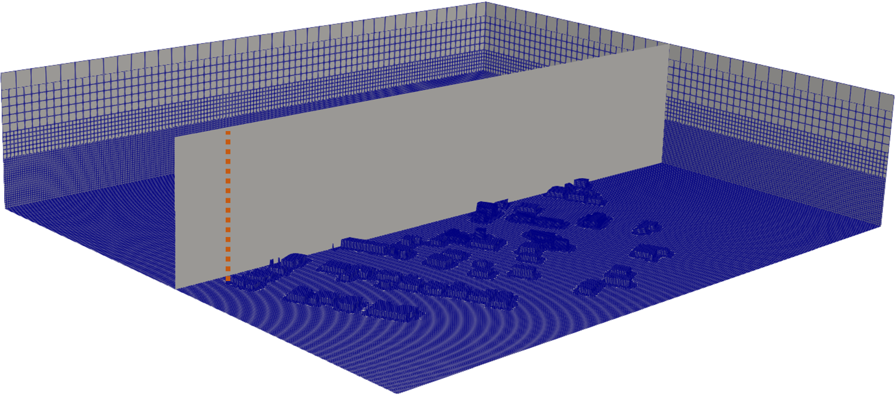

Visualization of the CFD output
"""""""""""""""""""""""""""""""

**Mesh**

:numref:`fig-advanced-cfd-4` shows the perspective view of the computational domain used in the example and :numref:`fig-advanced-cfd-5` shows the mesh refinement levels. It can be seen that the mesh is finer near the buildings and even finer near the buildings in the ROI. A cross section of the mesh levels along the flow direction can be viewed in :numref:`fig-advanced-cfd-21`.

.. _fig-advanced-cfd-21:

.. figure:: figures/Picture21.png
   :align: center
   :width: 50%

   Typical cross section along the flow direction.

**Wind profile**

:numref:`fig-advanced-cfd-22` shows the mean velocity profile at the inlet at the end of the simulation. The OpenFOAM wind profile is almost the same as the Target wind input.

.. _fig-advanced-cfd-22:

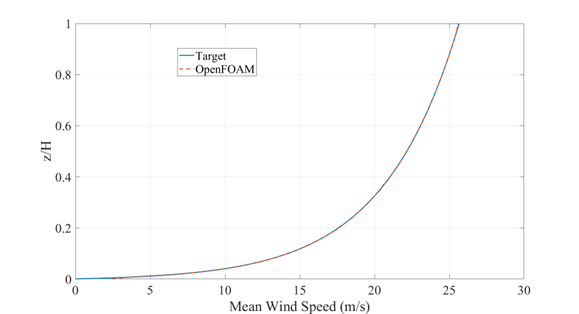

   Typical cross section along the flow direction.

**Pressure and velocity field slices**

:numref:`fig-advanced-cfd-23` shows the pressure and velocity fields at a height of z = 3m at the end of the simulation.  We can see that the boundaries are not much affected by the buildings which shows that the boundaries are far enough to not cause any significant changes to the wind flow in the vicinity of the region.

.. _fig-advanced-cfd-23:

.. figure:: figures/Picture23.png
   :align: center
   :width: 50%

   Velocity and pressure field at z=3m.

Manipulating the OpenFOAM files for miscellaneous simulations
^^^^^^^^^^^^^^^^^^^^^^^^^^^^^^^^^^^^^^^^^^^^^^^^^^^^^^^^^^^^

The above workflow produces an OpenFOAM workflow specifically for the ABL flow in an urban environment. The same workflow can be used for other types of wind simulations, such as wind flow in a wind tunnel or wind flow over user-defined structures (any geometry). Here’s a breakdown of the parameters and files that can be modified to run any kind of wind simulation.

Domain Extents and boundaries
"""""""""""""""""""""""""""""

The ``blockMeshDict`` file contains the details of the domain extents, the number of cells in each direction, and the boundary type. The users can change the vertices of the domain as per their choice, and also the number of cells in each direction in the blocks section of the file. The boundary patches can be modified in the boundary section. If the user wishes to define faces other than sides as cyclic, they can change the type to cyclic and add another argument as ``neighbourPatch`` with the patch that it’s cyclic with. If the user wishes to make another patch as a wall other than ground, they can just change the type from patch to wall. Make sure to also change the boundary conditions in the ``case/0/field`` variables files. Additionally, users can add more blocks and also define different mesh grading in all directions.

User-defined obstacles
""""""""""""""""""""""

If the user wants to define the geometry of the obstacles, they need to provide the STL file/s and move them to the ``case/constant/triSurface`` folder. The user needs to modify the surfaceFeaturesDict and the ``snappyHexMeshDict`` files. The user needs to remove the ROI.stl and Surrounding.stl files and put in the name of the user-defined STL file and the user-defined region name. The user can also modify the ``snappyHexMeshDict`` file to change the extent of refinement regions and add more regions if required. Additionally, the level of refinement can also be changed. The user is required to also modify the boundary conditions in the field variables in the ``case/0`` folder. The region of obstacles needs to be added in the boundaryField section.

User-defined initialization and inflow
""""""""""""""""""""""""""""""""""""""
The workflow provides options between a logarithmic wind profile and a TINF wind profile. However, if the user requires a different wind profile, they can modify the case/0/U, k, epsilon files for RANS and the case/0/U file for LES. In the boundaryField section, at the inlet, the user can input the profile of choice. If OpenFOAM v10 has standard profiles available, the user can visit the website and apply the condition as shown on the website. Alternatively, the user can assign the value of a variable at each face of the inlet boundary. This can be done in the following way:

1. In the case folder, after creating the mesh (blockMesh and snappyHexMesh), run the postProcess -func writeCellCentres command to get the coordinates of each face at the boundary and each cell in the domain. The coordinates are saved in the files “C”, “Cx”, “Cy”, and “Cz” files inside the case/0 folder. 

2. Extract the y and z coordinates for the inlet face and then calculate the variables at each of those coordinates using a Python script or a MATLAB script. 

3. The following format can then be used to input into the inlet patch of the boundaryField section of a field variable:

.. code-block:: boundaryField section 

   type     fixedValue;

   value    nonuniform  List<scalar or vector>

   Number of inlet faces

   (
       Values (if vector then (value1 value2 value3)
   );

A similar procedure can be used to input a user-defined initial profile inside the domain. The change would be made in the internalField section. Instead of a uniform, a nonuniform value would have to be described. All three coordinates would be required to calculate the profile values.

Mapping fields
""""""""""""""""
It is common to run a coarser or a RANS simulation before running an LES simulation to initialize the variables for faster convergence. A “mapFieldsDict” file is required to do that. An example of such a file is shown in :numref:`fig-advanced-cfd-3`. The user can modify the dict according to the requirements. The user can then map fields from one folder to another using the following command: 

``mapFields path_to_source_folder -sourceTime -latestTime``. 

Type ``mapFields -help`` for more options. 

.. _fig-advanced-cfd-7:

.. figure:: figures/Picture7.png
   :align: center
   :width: 50%

   An example of the mapFieldsDict file.

Turbulence Modeling and wall functions
""""""""""""""""""""""""""""""""""""""""

If the user wishes to use different models, such as DES (Detached Eddy Simulations), RANS , or LES dynamic Smagorinsky, then the user would need to modify the turbulenceProperties file and add or remove field variables depending on the needs of the model. The usage for other turbulence models can be found in the OpenFOAM documentation.

The workflow described above uses standard ABL wall functions. However, different wall functions can be used if the user needs. The nut, k, epsilon files must be modified to implement the wall function. The modification needs to be made in the wall boundaries in the boundaryField section.

.. [Franke2007] Franke, J., Hellsten, A., Schlünzen, K.H. and Carissimo, B., 2007. COST Action 732: Best practice guideline for the CFD simulation of flows in the urban environment.
.. [Spalding1974] B.E. Launder and D.B. Spalding. Computer methods in applied mechanics and engineering, 3(2):269–289, 1974.
.. [Smagorinsky1963] Smagorinsky, J.  General Circulation Experiments with the Primitive Equations I: the Basic Experiment. Monthly Weather Review, 91(3):99-164, 1963..
